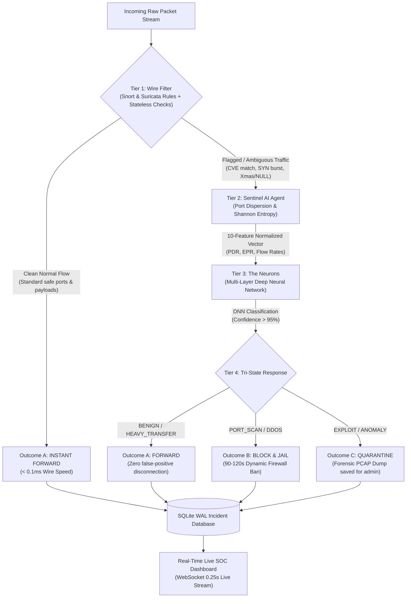
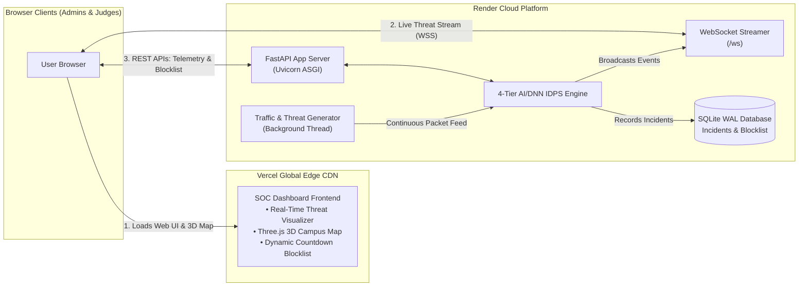
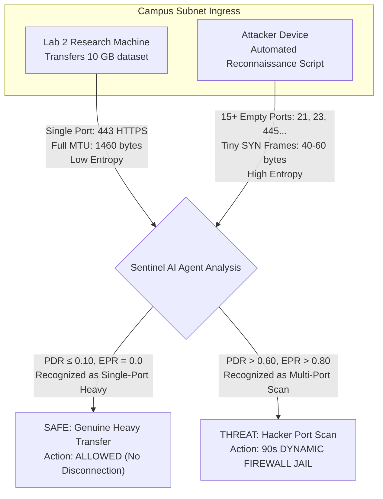

# 🛡️ SENTINEL EDGE: Autonomous Lightweight Edge IDPS & Forensics

> **Hackathon Edition**: Mid-Enterprise & Campus Network Edge Defense Engine  
> **Key Innovation**: Dual Suricata/Snort Fast Wire Filter + Sentinel AI Agent + Multi-Layer Neurons (DNN) + Tri-State Autonomous Response.

[](https://python.org)
[](https://fastapi.tiangolo.com)
[](https://sentinel-edge-static.vercel.app/)
[](https://sentinel-edge.onrender.com/)
[](LICENSE)

---

## 🌐 Live Deployments

Experience SentinelEdge live in action:

| Service | Link | Description |
| :--- | :--- | :--- |
| **🚀 Production SOC Dashboard** | **[sentinel-edge-static.vercel.app](https://sentinel-edge-static.vercel.app/)** | Hosted on Vercel Edge CDN with interactive 3D Campus map |
| **⚡ Edge Engine & WebSocket API** | **[sentinel-edge.onrender.com](https://sentinel-edge.onrender.com/)** | Hosted on Render (FastAPI + WebSocket + AI Engine) |
| **📦 GitHub Repository** | **[chandrakanthGupta/sentinel-edge](https://github.com/chandrakanthGupta/sentinel-edge)** | Complete source code, Docker configs & documentation |

---

## 📊 System Architecture & Data Flow

### 1. The 4-Tier Inspection & Triage Pipeline



---

### 2. Dual Cloud Deployment Architecture (Vercel + Render)



---

### 3. Critical Differentiator: Genuine Heavy Transfer vs. Hacker Port Scan



| Metric | Genuine Heavy Transfer | Hacker Port Scan |
| :--- | :--- | :--- |
| **Target Ports** | **Single Port** (e.g., 443 HTTPS or 8080) | **15+ Empty/Closed Ports** (21, 23, 135, 139, 445, 1433, 3389...) |
| **Packet Size** | Full Ethernet MTU (1460 bytes) | Tiny SYN frames (40-60 bytes) |
| **Port Diversity Ratio (PDR)** | Extremely low ($\le 0.05$) | Very high ($\ge 0.85$) |
| **Empty-Port Rejection (EPR)** | $0.0$ | Approaching $1.0$ |
| **SentinelEdge Action** | **ALLOWED** (Never disconnected) | **TERMINATED** (90-second Dynamic Firewall Jail) |

---

## 🚀 Quick Start Guide

### Option 1: Run Locally

```bash
# 1. Clone the repository
git clone https://github.com/chandrakanthGupta/sentinel-edge.git
cd sentinel-edge

# 2. Install dependencies
pip install -r requirements.txt

# 3. Launch SentinelEdge engine & dashboard
python main.py
```
Open your browser at: 👉 **`http://127.0.0.1:8000`**

### Option 2: Run with Docker Compose

```bash
docker compose up -d --build
```
Open your browser at: 👉 **`http://localhost:8000`**

### Option 3: Deploy to Cloud (Render / Railway)

- **Repository**: `https://github.com/chandrakanthGupta/sentinel-edge`
- **Build Command**: `pip install -r requirements.txt`
- **Start Command**: `python main.py`
- **Port**: Auto-detected via `$PORT` environment variable (defaults to `8000`)

---

## 🎬 Live Hackathon Demo Script (Pitch Guide)

1. **The Edge Problem**:
   * *"Traditional security appliances like Palo Alto cost tens of thousands of dollars, while open-source stacks like Suricata + Zeek + Elasticsearch require 4-8 GB of RAM and high CPU. Mid-sized colleges and enterprises cannot afford or run them on edge routers."*

2. **The SentinelEdge Solution**:
   * Show the telemetry bar on the live dashboard: **Edge RAM: ~32 MB | CPU: < 3% | Wire Latency: 0.3 ms**.
   * *"SentinelEdge is hyper-lightweight. It runs directly on the router's management tap with sub-millisecond wire response."*

3. **Demonstrate Zero False Positives**:
   * When genuine heavy transfers stream across the network, SentinelEdge recognizes single-port bulk transfers and **delivers them safely without disconnecting the user**.

4. **Demonstrate Automated Port Scan Termination**:
   * Watch the pipeline light up:
     * **Tier 1** flags multi-port velocity.
     * **Tier 2** measures empty-port dispersion and Shannon entropy.
     * **Tier 3 Neurons** confirm `PORT_SCAN` at 98%+ confidence.
     * **Tier 4** autonomously terminates the attacker IP and places them in the **Dynamic Firewall Blocklist with a live countdown timer**! Any subsequent packet from that IP is dropped instantly at wire edge.

5. **Show Wireshark Forensic Integration**:
   * In the Live Incident Table, click **`[ Inspect ]`** on an incident.
   * View the raw Hex/ASCII payload dump.
   * Click **`[ 📥 Export Wireshark .pcap ]`** to download a synthetic, Wireshark-compatible binary PCAP file for forensic analysis.

---

## 📂 Codebase Structure

```
sentinel-edge/
├── main.py                          # Main launcher for IDPS engine & dashboard server
├── sentinel_core.py                 # Core orchestrator routing packets through Tiers 1-4
├── requirements.txt                 # Python dependencies (FastAPI, uvicorn, numpy, psutil, etc.)
├── Dockerfile                       # Production container definition
├── docker-compose.yml               # Multi-container orchestration config
├── tier1_wire_filter/               # TIER 1: Suricata & Snort rule parser and fast stateless engine
│   ├── engine.py
│   └── sentinel.rules               # Snort/Suricata rules (CVEs, SQLi, Log4j, probes)
├── tier2_agent/                     # TIER 2: Sentinel AI Agent
│   └── agent.py                     # Flow aggregator, port dispersion, Shannon entropy profiler
├── tier3_neurons/                   # TIER 3: The Neurons (DNN)
│   ├── neurons.py                   # Multi-layer neural network classifier
│   └── weights.json                 # Pre-trained deep neural weights
├── tier4_response/                  # TIER 4: Autonomous Response Engine & Forensics
│   ├── response_engine.py           # Tri-state actuator (Forward / Jail / Quarantine)
│   ├── database.py                  # High-performance SQLite WAL database interface
│   └── sentinel_incidents.db        # Checkpointed incident records
├── simulation/                      # Continuous traffic and attack generator
│   └── traffic_generator.py         # Simulates campus subnets, heavy transfers, port scans
├── dashboard/                       # SOC Dashboard web application
│   ├── server.py                    # FastAPI server with WebSocket & REST endpoints
│   └── static/                      # Frontend dark-mode SOC interface
│       ├── index.html               # Main dashboard UI
│       ├── style.css                # Custom cybersecurity HUD styling
│       ├── app.js                   # WebSocket client & real-time telemetry renderer
│       └── campus3d/                # Three.js 3D Campus interactive map
└── poster/                          # Academic presentation materials
    ├── poster.html
    └── POSTER_PRESENTATION.md
```

---

## 📜 License

This project is licensed under the MIT License - see the [LICENSE](LICENSE) file for details.
